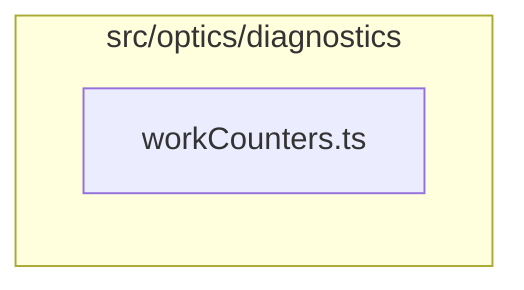

# src/optics/diagnostics

This folder compile-time-gated work counters that benchmarks, harnesses, and tests read to compare engine work.

Generated `readme.md` and `improvementsuggestions.md` files are intentionally omitted from the per-file inventory so this document stays focused on source relationships.

## Relationship Diagram

## Directory Overview

- Direct source files: 1
- Direct subfolders: 0
- Main outbound areas: none
- External consumers: src/optics/diagnostics.ts, src/optics/dispersion.ts, src/optics/field, src/optics/internal, src/optics/math, src/optics/perspective, src/optics/prescription, src/optics/runtimeLens.ts, +2 more

## Files

| File | Role | Imports from | Imported by | Exports |
| --- | --- | --- | --- | --- |
| `workCounters.ts` | Work Counters helper module | none | src/optics/math (3), src/optics/internal (2), src/optics/trace (2), src/optics/diagnostics.ts, src/optics/dispersion.ts, +5 more | OPTICS_COUNTERS_ENABLED, WorkCounters, WorkCounterSnapshot, workCounters, snapshotWorkCounters, resetWorkCounters |
